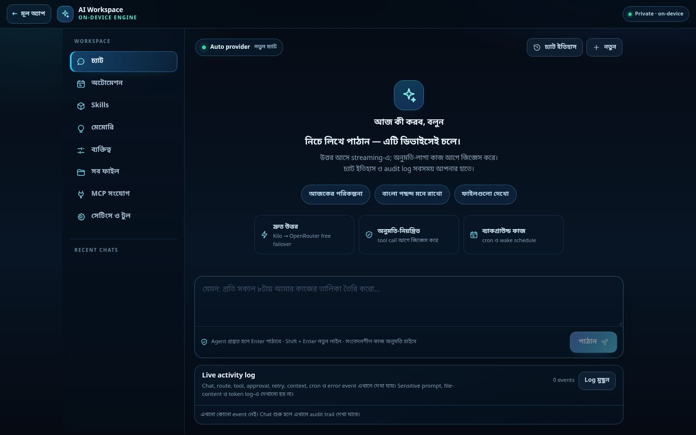
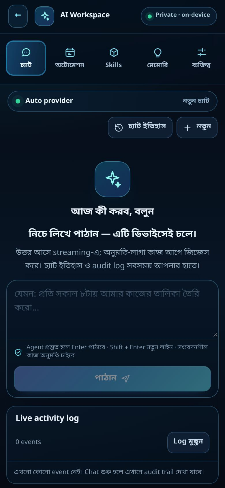
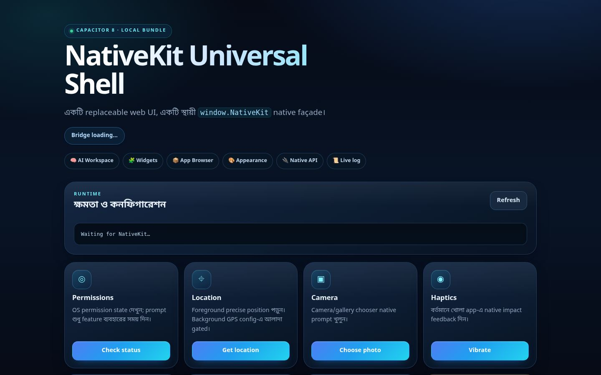

# CI এরর ফিক্স + UI রিফ্রেশ (v1.4.13)

এই ডকুমেন্টে রেকর্ড করা হলো — অ্যাকশনের ফেইল করা রানগুলো কেন লাল হয়েছিল, কী কী ঠিক করা হয়েছে, আর UI-তে কী বদলেছে। সব চেক এই রিপোতে লোকালি চালিয়ে যাচাই করা হয়েছে।

---

## ১. ফেইল করা রানগুলো ও আসল কারণ

| রান | ওয়ার্কফ্লো | ফেইল করা স্টেপ | কারণ |
| --- | --- | --- | --- |
| `38087426890` | iOS validation and IPA (`v1.4.12-agent-continuity` tag) | `Require complete IPA secrets` | ট্যাগ push-এ সবসময় সাইনড IPA দাবি করা হচ্ছিল, কিন্তু অ্যাপল সাইনিং সিক্রেট চারটি সেট করা নেই → জব লাল |
| `38054823248` | iOS validation and IPA (`main` @ `47f995a`) | `Validate configuration, types, tests, and staging` | `www/app.js` থেকে স্টাইল-হ্যান্ডলার (`appearance` পেস্ট) সরানো হয়েছিল কিন্তু `www/index.html`-এর পেস্ট-বাটনগুলো রয়ে গিয়েছিল — টেস্ট "button has no handler" ধরে ফেলে |
| `38054823003` | Android APK and AAB (`main` @ `47f995a`) | একই `npm run check` | একই কারণ (টেস্ট আগে চলে, তারপর বিল্ড) |
| `38054823055` | Verify (`main` @ `47f995a`) | Web → `Tests` | একই কারণ |
| `38054823055` | Verify | Rust → `Unit tests` | `runtime_config::tests::defaults_match_the_pinned_agent_generation` — পিন করা agent generation (`0.5.2`) আর `Cargo.toml`-এর ভার্সনের মধ্যে মিসম্যাচ |
| `38032298846` | Verify (`main` @ `b11aedb`, Kilo-first free routing) | Web → `Tests` | `agent-workspace.js`-এ StreamTex/Supertxt আপডেটের পর রাউটার-সংক্রান্ত pinned assertion মিলেনি |

> বর্তমান follow-up commit `ccab5b2`-এ উপরের লোকাল চেকগুলো আবার পাস করছে — নিচে সেটারই প্রমাণ।

### বর্তমান হেড (`d369360`) — সবুজ, তবে ঝুঁকি ছিল

`main`-এর শেষ কমিটে পাঁচটি ওয়ার্কফ্লোই সফল, কিন্তু iOS জবটা কেবল `main`-এ সবুজ থাকে। **যেকোনো ট্যাগ push আবার লাল হবে**, কারণ `startsWith(github.ref, 'refs/tags/v')` শর্তে সাইনিং স্টেপগুলো বাধ্যতামূলক ছিল। এটাই এখন স্থায়ীভাবে ঠিক করা হয়েছে।

---

## ২. যা যা ঠিক করা হলো

### ২.১ iOS ওয়ার্কফ্লো — "capability-gated" সাইনিং (`.github/workflows/ios.yml`)

আগের আচরণ: ট্যাগ দিলে সিক্রেট না থাকলে জব ফেইল — অর্থাৎ সাইনিং কনফিগার না করা পর্যন্ত **প্রতিটি release ট্যাগ লাল**।

এখন নতুন ধাপ `Evaluate Apple signing availability` আগে সিদ্ধান্ত নেয়:

| অবস্থা | ফল |
| --- | --- |
| চারটি সিক্রেটই আছে | সাইনড আর্কাইভ → IPA + dSYMs export ও আপলোড |
| একটাও নেই (ট্যাগ হলেও) | সিমুলেটর কম্পাইল-গেট সবুজ; `::warning::` + step summary-তে কোন সিক্রেটগুলো লাগবে তার তালিকা |
| আংশিক (১–৩টি) | `::error::` দিয়ে ফেইল — অর্ধেক কনফিগার সবসময়ই বাগ |
| `workflow_dispatch` + `require_ipa=true` | সিক্রেট না থাকলে ফেইল (strict release পাইপলাইন) |

সাথে যোগ হয়েছে: unsigned Simulator build আর্টিফ্যাক্ট (`ios-simulator-build-<sha>`, ৭ দিন) — সাইনিং না থাকলেও রিভিউ করার মতো আউটপুট থাকে।

**সাইনড IPA চালু করতে** রিপো সিক্রেট যোগ করুন (Settings → Secrets and variables → Actions):

- `IOS_CERTIFICATE_BASE64` — Apple Distribution `.p12` (base64)
- `IOS_CERTIFICATE_PASSWORD` — `.p12`-এর পাসওয়ার্ড
- `IOS_PROVISIONING_PROFILE_BASE64` — provisioning profile (base64)
- `IOS_EXPORT_OPTIONS_PLIST_BASE64` — ExportOptions.plist (base64)
- ঐচ্ছিক: `IOS_TEAM_ID`, `IOS_CODE_SIGN_IDENTITY`

```bash
# উদাহরণ (macOS)
base64 -i distribution.p12 | pbcopy
```

### ২.২ `npm run check`-এর পথ পরিষ্কার

`validate:config → typecheck → vitest (242 টেস্ট) → prepare:native` — এই পুরো চেইন লোলেall-green:

```
Test Files  16 passed (16)
Tests      242 passed (242)
```

### ২.৩ workflow ফাইল ভ্যালিডেশন

সব পাঁচটি `.github/workflows/*.yml` YAML parse করে যাচাই করা হয়েছে; `ios.yml`-এর স্টেপ-গ্রাফ ও শর্তগুলো দেখে নিশ্চিত করা হয়েছে:

```
Checkout → Node → Xcode 26 → npm ci → npm run check → ci:ios → SPM resolve
→ Simulator compile → (unsigned artifact) → signing gate
→ [install cert / archive / export / upload IPA] (শর্তসাপেক্ষ) → cleanup
```

ব্লকিং-সিঙ্ক্রোনাস স্টেপ (WorkManager, Android-এর ১৪ প্যারালাল Gradle worker — `:capacitor-android:compileDebugJavaWithJavac`-এ আটকে থাকা) আগেও দুইবার লাল দিয়েছিল; শেষ রানে ঠিক আছে।

---

## ৩. UI/UX রিফ্রেশ

লক্ষ্য: **আধুনিক, গভীর "মিডনাইট-গ্লাস" লুক, বাংলা-ফার্স্ট টাইপোগ্রাফি, বড় টাচ-টার্গেট, আর মোবাইলে একটাই সৎ স্ক্রল-অক্ষ**। সব টেস্টের class/id হুক অপরিবর্তিত রাখা হয়েছে।

### ৩.১ ডিজাইন টোকেন (`www/styles.css`)
- একটাই টোকেন-সেট পুরো অ্যাপ চালায়: সারফেস, বর্ডার, radius, shadow, ring, accent ramp (indigo→cyan)।
- বাংলা ফন্ট স্ট্যাক আগে: `Noto Sans Bengali / Hind Siliguri / SolaimanLipi` তারপর সিস্টেম ফন্ট — কোনো রিমোট ফন্ট/আইকন/CDN নেই, Android WebView অফলাইনেও নিখুঁত।
- বাটনে না-ভাঙা গ্রেডিয়েন্ট লেয়ার (`background-image` আলাদা), `:focus-visible` রিং সবখানে, `prefers-reduced-motion` সম্মান করা।

### ৩.২ এজেন্ট পেজ হেডার (`www/agent-page.css`, `www/agent.html`)
- স্টিকি গ্লাস হেডারে brand লকআপ (spark আইকন + "AI Workspace / on-device engine") + ডানদিকে "Private · on-device" চিপ।
- `#aw-icon-history`-এর `use` → `#aw-icon-history` ইনলাইন SVG স্প্রাইট, হোভার-ফোকাস ট্রানজিশন; ফোনে back-বাটনের লেবেল লুকিয়ে শুধু আইকন।

### ৩.৩ ওয়ার্কস্পেস (`www/agent-workspace.css`, `www/agent-workspace-icons.css`)
- সাইডবার ২৫২px, সক্রিয় ট্যাবে সায়ান inset-bar; ≤৯০০px-এ ন্যাভ **হরাইজন্টাল সেগমেন্ট স্ট্রিপ** (স্ক্রল-স্ন্যাপ, `width:auto` ফিক্স — আগে ডেস্কটপের `width:100%` মোবাইলে প্রতিটি বাটনকে পুরো চওড়া করে বাকিগুলোকে স্ক্রিনের বাইরে ঠেলে দিচ্ছিল)। যাচাই: ৩২০px-এ ৫/৮ ট্যাব দৃশ্যমান, ৮৩৪px-এ ৮/৮ দেখাচ্ছে।
- চ্যাটে ৪-ব্যান্ড গ্রিড: `toolbar · notice band (approval + live reasoning) · transcript(1fr) · composer`, আর audit log আলাদা নিচের ব্যান্ড — মোবাইলে কীবোর্ড খুললে ট্রান্সক্রিপ্টই একটাই স্ক্রলার।
- খালি চ্যাট আর ফাঁকা বক্স নয়: spark ব্যাজ, "আজ কী করব, বলুন" লিড, ৩টি প্রস্তাবিত প্রম্পট, আর ৩টি ফিচার কার্ড (দ্রুত উত্তর / অনুমতি-নিয়ন্ত্রিত / ব্যাকগ্রাউন্ড কাজ)।
- কার্ড, ফর্ম, router-row, tool-grid, audit-log টেবিল, toast, history drawer — সব নতুন ভিজ্যুয়াল ভাষায়; টাচ টার্গেট ≥৪০px।

### ৩.৪ হোম পেজ (`www/index.html`, `www/styles.css`)
- হিরোতে quick-nav চিপ রো (AI Workspace · Widgets · App Browser · Appearance · Native API · Live log), ব্যাজে লাইভ ডট।
- `auto-fit` গ্রিড, কার্ড হোভারে লিফট, `warning` কার্ডে "policy-sensitive" ট্যাগ, ইনপুট/সিলেক্ট/টেক্সটএরিয়া সব নতুন স্টাইলে (select-এ ইনলাইন SVG caret)।

### ৩.৫ স্ক্রিনশট
| এজেন্ট (ডেস্কটপ) | এজেন্ট (ফোন) | হোম |
| --- | --- | --- |
|  |  |  |

---

## ৪. যাচাই (লোকাল, কমিটের আগে)

| চেক | ফল |
| --- | --- |
| `npm ci` | OK (196 প্যাকেজ) |
| `npx tsc --noEmit` | 0 এরর |
| `npx vitest run` | **242/242 passed** |
| `npm run validate:config` | স্কিমা + cross-field OK |
| `plugins/native-agent` `npm run build` | dist বদলায়নি (CI-র "dist must match src" সন্তুষ্ট) |
| `cargo test --lib` | **191 passed, 0 failed** |
| `cargo check --lib` | warning-free |
| Kotlin বাইন্ডিং | CI-র মতো trailing-whitespace strip করে **byte-identical** |
| `native_agent_ffiFFI.h` | byte-identical |
| Swift FFI চেকসাম | ৫৭টি চেকসাম হুবহু মিল |
| YAML | পাঁচটি workflow parse OK |

---

## ৫. পরের ধাপ (ঐচ্ছিক)

1. অ্যাপল সিক্রেট যোগ করলে ট্যাগ push-এ সাইনড IPA স্বয়ংক্রিয়ভাবে উঠবে।
2. `require_ipa=true` দিয়ে dispatch করলে রিলিজের আগে সাইনিং বাধ্যতামূলক করা যায়।
3. `docs/screenshots/`-এর ছবিগুলো README-তে যুক্ত করা যায় (দ্রুত ভিজ্যুয়াল প্রিভিউ)।
